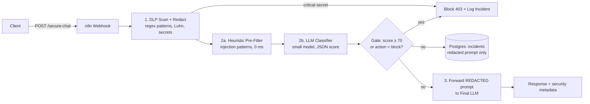

# 🔐 AI Security Gateway — DLP & Anti-Prompt-Injection Proxy

An API gateway (built in **n8n**, with a runnable **FastAPI reference implementation**) that sits in front of any LLM and stops the two things you must never let reach — or leak out of — a model: **sensitive data (PII / secrets)** and **prompt-injection / jailbreak attacks (OWASP LLM01)**.

Every request is inspected, sanitized, and scored *before* the final LLM ever sees it. Malicious requests are blocked and logged; clean requests are forwarded with their secrets already redacted.

> Portfolio project by **Gilberto A. Cedillo Soto (Abisaíd)** — Cybersecurity, BYU-Idaho (Class of 2027)
> `n8n` · `Python / FastAPI` · `DLP` · `OWASP LLM Top 10` · `Prompt Injection` · `Postgres / Supabase`

---

## Architecture



```
Client ──► Webhook ──► DLP ──► Heuristics ──► LLM Classifier ──► Gate ──┬─► ✋ Block 403 + incident log
                                                                        └─► Final LLM (sanitized) ──► Answer
```

**Defense in depth — no single layer is trusted alone:**
1. **DLP (deterministic, first)** — regex engine for emails, US SSNs, phone, credit cards (Luhn-validated), AWS keys (`AKIA…`), OpenAI/Anthropic/GitHub/Slack tokens, private keys, JWTs, `password=` assignments. Live secrets **fail closed**: blocked in strict mode, never forwarded.
2. **Heuristic injection pre-filter** — pattern scoring for `ignore previous instructions`, DAN/developer-mode, system-prompt extraction, delimiter smuggling, encoding tricks, zero-width token smuggling, markdown exfiltration. ~0 ms, no API cost.
3. **LLM classifier** — a small fast model returns strict JSON `{injection_score, category, rationale, action}` (see [`prompts/llm-injection-classifier.md`](prompts/llm-injection-classifier.md)). The untrusted input is delimiter-wrapped and treated as data, never as instructions to the classifier.
4. **Deterministic gate** — the classifier *proposes*; code *decides*: `block` if `score ≥ 70` + block action, `score ≥ 85` from either layer, or critical DLP in strict mode.
5. **Incident logging** — blocked (and suspicious) requests are written to Postgres/Supabase ([`db/schema.sql`](db/schema.sql)) with the **redacted** prompt only. Raw secrets are never stored — a log of raw prompts would itself become a secret store.

---

## OWASP LLM Top 10 mapping

| Risk | How this gateway addresses it |
|---|---|
| **LLM01 Prompt Injection** | Heuristic pre-filter + LLM classifier + deterministic block gate; delimiter-wrapped classification, indirect-injection patterns (markdown exfil, encoding tricks) |
| **LLM02 Sensitive Information Disclosure** | DLP redaction before forwarding; secrets fail-closed; logs store redacted prompts + masked previews only |
| **LLM06 Excessive Agency** | Gateway only forwards text; no tools/functions are exposed to the user prompt; final LLM receives a sanitized, single-turn prompt |
| **LLM07 System Prompt Leakage** | `prompt_extraction` category explicitly scored and blocked; system prompts are never in the forwarded context |
| **LLM08 Vector/Embedding weaknesses** | Out of scope (no RAG in v1) — see Roadmap |
| **LLM10 Unbounded Consumption** | Prompt length capped (20k chars in FastAPI, slice in n8n), classifier uses a small model with a 5 s timeout |

---

## Repository layout

```
n8n/workflow/ai-security-gateway.json   Importable gateway workflow (Webhook → DLP → Classifier → Gate → Log → Final LLM → Respond)
gateway/dlp.py                          Standalone DLP engine (regex library, redaction, Luhn)
gateway/injection_patterns.py           Heuristic injection pre-filter + risk scorer
gateway/app.py                          FastAPI reference implementation (POST /secure-chat, /health)
prompts/llm-injection-classifier.md     Classifier system prompt, JSON schema, few-shot examples
db/schema.sql                           incidents table (Postgres / Supabase)
tests/test_dlp.py                       11 pytest tests (DLP redactions + injection scorer)
examples/                               Blocked jailbreak, PII + redacted version, clean request
docs/interview-defense-guide.md         How the design decisions are explained/defended
```

---

## Setup

### Option A — n8n (the gateway as designed)
1. n8n → **Workflows → Import from File** → `n8n/workflow/ai-security-gateway.json` → Activate.
2. Set env vars (see `.env.example`): `OPENAI_API_KEY`, `INCIDENT_WEBHOOK_URL` (Supabase REST insert or any receiver), optionally replace the disabled Postgres node (7b) with direct DB credentials.
3. Apply the DB schema: `psql "$DATABASE_URL" -f db/schema.sql`
4. Your gateway URL is `https://<your-n8n>/webhook/secure-chat`.

### Option B — FastAPI (run/test locally, no n8n)
```bash
pip install -r requirements.txt
cp .env.example .env          # no key needed for the offline stub mode
uvicorn gateway.app:app --port 8000
python -m pytest tests/ -q    # 11 tests
```
Without `OPENAI_API_KEY`, the final-LLM step returns a stub echo — the full security pipeline (DLP → heuristics → gate → logging) still runs for real.

---

## API usage

```bash
curl -X POST https://<your-n8n>/webhook/secure-chat \
  -H 'Content-Type: application/json' \
  -d '{"prompt": "Draft an email for me, I am maria.garcia@example.com, explain AI in 2 sentences", "session_id": "demo-1"}'
```

**200 — forwarded (sanitized):**
```json
{
  "answer": "Artificial intelligence is ... (answer from the final LLM, which saw [REDACTED_EMAIL], not the real address)",
  "security": { "dlp_redactions": 1, "dlp_findings": [{"type": "email", "severity": "medium", "count": 1, "masked_preview": "mari********.com"}], "injection_score": 2 }
}
```

**403 — blocked jailbreak** (see [`examples/blocked-jailbreak-request.json`](examples/blocked-jailbreak-request.json)):
```json
{ "blocked": true, "reason": "prompt_injection_score_97", "security": { "dlp_redactions": 0, "dlp_critical": false } }
```

**403 — live secret (fail-closed):** a prompt containing an `AKIA…` key or `sk-…` token is blocked with `critical_dlp_secret_detected`. The secret is never forwarded, never logged in full — only a masked preview (`AKIA************MPLE`) is stored.

---

## Latency & security trade-offs

| Choice | Cost | Why it's worth it |
|---|---|---|
| DLP + heuristics before any LLM call | ~1–5 ms | Deterministic, free, and prevents secrets leaking *to the classifier itself* |
| LLM classifier on the critical path | ~600–1200 ms | Catches paraphrased/novel injections that regex cannot; kept cheap with a small model + 5 s timeout |
| Fail-closed for critical secrets | Some false-positive blocks (e.g. posting an example key in a tutorial) | A leaked live key is worse than a blocked request; strict mode is configurable (`STRICT_DLP_BLOCK=false`) |
| Logging redacted prompts only | Less forensic detail | Raw-prompt logs become a credential/PII store — a worse incident than the ones you're logging |

**Known limits (stated honestly):** regex DLP misses obfuscated secrets (spaced-out keys, images); a classifier LLM can itself be attacked — that's why it never decides alone and why heuristics + the deterministic gate exist. This is a portfolio/lab gateway, not a certified DLP product.

## Roadmap
- [ ] Indirect injection scanning for retrieved/RAG content (LLM01 indirect + LLM08)
- [ ] Output-side DLP: scan the LLM *response* for leaked system prompt / PII before returning it
- [ ] Per-session rate limiting + score trending in the incidents table
- [ ] Additional locales for PII (MX CURP/RFC, IBAN) and a secrets entropy scorer

## License
MIT © 2026 Gilberto A. Cedillo Soto
